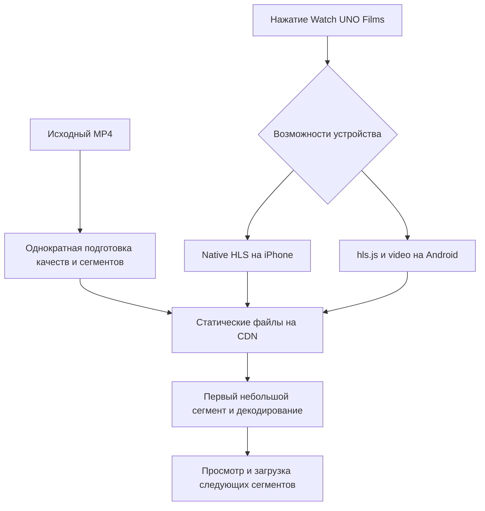

# Standard UNO Product Film — CHG0135

Current implementation: [mobile HLS delivery, CHG0141](#mobile-hls-delivery--chg0141). User authorized reusable skill, integration and deployment on2026-10-23. The standard MP4 section below is historical; current validation/publication status is recorded under CHG0141.

Scope2026-10-23: use the supplied English introduction as a single unmodified MP4 in browser-native video controls. No adaptive streaming or advanced delivery research in this request.

Both existing `film-play` circle (source390,11439,width160) and `film-label` text (280,11600,width380) open the same native modal. Artwork, font, copy, geometry and941px canvas unchanged. Source scale402/941 on Pro,440/941 on Max. Closed screenshot compares before/after and calibrated background_text crop; new dialog has no supplied reference and is checked for usable native controls/uncropped16:9 and safe-area fit.

On intent attach `/films/uno-introduction.mp4` and invoke play within the gesture. Native controls handle pause, seek, audio and fullscreen; `playsInline` allows a choice of inline/fullscreen on phones. Orientation hint asks user to enter fullscreen and rotate; no forced orientation. Dialog close/Escape release src/stop transfer and audio, retain main scroll and return trigger focus. Error shows translated Retry, loading feedback remains visible until playable; source is English for all11 interface locales, explicitly labeled. No subtitles supplied; no captions/WCAG-compliance claim.

No src before intent is stronger than relying on preload hint. Static native HTTP delivery must demonstrate HEAD and206 byte ranges/seek. No Blob download, app API proxy, player dependency or whole-file fetch. Prepare ignored local public asset from source;344MB original excluded from Git. Publication requires an approved host able to serve a file of this size with Range; current task is local implementation without push/upload.

Acceptance: primary Pro/Max DPR3 WebKit before/after closed, open portrait and landscape images; controls/keyboards/Escape/focus/reopen/cleanup/actual playback+seek/error+Retry/slow; all11 locale keys and overflow, Arabic screenshot,280–1440 adaptation; production build/type/lint/native review, initial0video bytes and load metrics/JS/CLS/scroll comparison. Browser-native fullscreen API verified only on supporting engines; physical iOS chrome/orientation/embedded browsers remain unverified.

Source:344657039bytes,60.04s,3840×2160 H264 High level5.1, AAC sample entry; moov at28 before mdat844642 (fast-start layout), combined average45.924Mbps. No transcode; inspect exact metadata and playback before approval.

Known standard-server edge: CHG0136 OPEN, Next16.2.11 returns500 to an out-of-file Range instead of416. Valid0/mid/end Range requests are206 with exactbytes. No application delivery proxy was added; include negative ranges when evaluating publication hosting.

The player does not transcode, reduce4Kbitrate or choose quality. HTTPRange allows start/seek before the entire file is downloaded; browsers may buffer far ahead or request an open-ended range, so partial delivery is not a cap on bytes. Full viewing remains approximately344.7MB. At10Mbps the ideal wholefiledownload takes276seconds for60seconds of content; pauses are likely. Playbackcontrols/fullscreen/PiP/AirPlay vary bybrowser/OS; orientationlock canprevent rotation. No captions/subtitles supplied. Originalclaims remain sourcecontent, not verifiedproductfacts.

Local preparation: `node tools/prepare-product-film.mjs`, then normal frameworkbuild/start. Publicasset andoriginalvideoignoredbyGit. This is a localbaseline; no publicupload/push/deployperformed. Nativeplayer is a tiny clientboundary; stable11locale pages remainSSG, not request-rendered orclient-only.

Lifecycle acceptance includes same-task nativeclose/reopen3times with actualplayback; queuedoldclose cannotrelease newlyopenedsource. Ordinaryclose resetsresource to EMPTY/HAVE_NOTHING/time0 even though testedbrowser currentSrc retainscachedURL.

Verification2026-10-23: nativeactualplay/seek30s/pause/audio-enabledsource, bothtriggers/Enter/Escape/close/focus/reset, errorRetry/heldsourceclose tested onWebKitPro402×874DPR3/Max440×956DPR3,Chromium/Firefox. All11locales+ArabicRTL and280/375/440/768/874×402/956×440/1440 adaptationchecked. Correctedfullsuite19PASS9explicitmatrix/platformSKIP; finalguardaffected12PASS0SKIP. Assembledlongscroll andotherdialogactions passall4profiles. ClosedPro/Max frames before/after0RGBAchannelchanges; referencecrop visuallycompared, no claimofexactsourcepixelidentity.

Finalproduction coldChromium402DPR3, emulated4Mbps100ms4xCPU, one sample each: baseline/new LCP676/404ms, FCP468/364ms, CLS0.000222both; completedJS219347/219935B (+588), HTML229849/230226B (+377), video0requests/0B beforeintent. Scroll99unthrottledframes p9516.8msboth/one>33msboth. Timingdifference singletrial, not provenimprovement. Rendering remainsstatic11localeSSG; no meaningfulregression or reasonforSSR/heavyplayer. Rawdocs/evidence/video/performance.json andverification.json. Nativefullreviewclean aftertesttypingrepair, guardreviewclean; type/lint/buildpass, oneinheritedTelegramlintwarning. PhysicaliOSfullscreen/rotation, fieldINP, captions andLighthouse remainunverified/unprovided.

Additional standard-player10Mbps check: coldMP4 aftermainartready, Chromium402×874DPR3/100ms/CPUunthrottled/25swindow. Firstplaying3116ms; stalls at5.161→13.189s and15.341→23.787s walltime; at25.272s only5.579s contentelapsed,31,879,530mediaB received/tworequests, noerror. Closepaused/EMPTY/HAVE_NOTHING. This demonstrates the intentionally retained originalbitrate limitation, not an appregression or an instruction to start advancedstreaming work. Singlelocalemulatedsample docs/evidence/video/slow-network.json; screenshot screenshots/video/10mbps-native-pro.png.

CHG0137 supplementarytestmaintenance: identicalobsoletehidden-imageprerequisites removed acrossothergeneralsite-testconsumers. Additional22PASS/2BackToTopfixtureFAIL, thenfinal4profileBackToTopPASS afterwaitingmainartforitssettledgeometryscenario; full24consumerprofilescovered. NativeconsumerreviewCLEAN/type/lintPASS; applicationruntimeunchanged. Historicalfailures retainedinCHANGELOG.

Finallocaltechnicalapproval2026-10-23 /root: CHG0135+0137VERIFIED; independentauditorScope/visual/behaviorre-audit/quality+testsupplement/finalrecordre-auditPASS. Priorbehavior/recordFAILs retainedwithfixes; CHG0136remainsOPEN. UserresultapprovalNOT_RECORDED; EVAL-VIEWERcontrolledNOT_RUN. No publicationperformed.

## Git/Vercel publication — CHG0138
Owner explicitlyauthorizesGit→Vercel2026-10-23, supersedingthelocal-onlyrestriction/earlierstatementthatexternalhostingisrequired. Version `public/films/uno-introduction.mp4` throughGitLFS(exactpath in.gitattributes); privateoriginaldesign/video remainsignored. Vercel'sdocumentedGitLFSsupport canhydrateoncheckout. Buildscriptalsohydratesanunresolvedpointer frompublicGitHubLFS withoutcredentials/dashboardtoggle, streamingintotemporaryfile andrequiringexact344657039B/SHA71891983591abac3e44a076bf58a031ec8d6aa070a2e1acf046d3bb58c44bf25beforerename. Failurestopsbuild ratherthanpublishingpointerasvideo. SignedactionURLs/headersneverlogged. npmrunbuild nowpreparesfilmthenrunsnextbuild. `node tools/prepare-product-film.mjs --from-lfs` checksrealanonymousdownload independentlyofignoredlocalmaster.

Runtimeplayer/quality/bitrate unchanged. This is straightforwardsingleMP4delivery, notadvancedstreamingresearch. Publicationiscompleteonlyafterexactorigin/maincommitandbothknownVerceltargets succeedpluscanonicalpublicMP4206/exactbytes/realplayback. CorporateChromeblocktoVerceldashboardwasnotbypassed. NativecodepublicationreviewCLEAN; livehydration/build/publicchecks arebeingrecorded separately.

Published2026-10-23 as7e66adc671e01145862c148e8ea4f9fb3b7ce75e→origin/main, bothVercelSUCCESS/mainProduction7282937781/betaPreview7282914080. Publicramsider-main.vercel.app/en#film-play andramsider-bice.vercel.app: real344657039Bvideo/mp4/Rangebytes;3publicranges206exact. ActualcanonicalWebKitPro/MaxDPR3 play4K/seek30/close/focus/0video-before-intent/nooverflow/noerrors PASS, screenshotsviewedbyroot. No transcode; standardoriginalnetworklimitationsretained. Receiptspublication.json/public-browser.json; finalindependentpublicationGate6PASS2026-10-23/root/video_auditor; CHG0138VERIFIEDpublished. Postpublishoutcomeslocalonly.

## Mobile HLS research — CHG0140

Исследование от 2026-10-23. Решение о реализации принимает пользователь после прочтения. Приложение, зависимости, исходник и опубликованная версия не изменены. CHG0139 остаётся OPEN: это исследование не исправляет наблюдаемую остановку и не устанавливает точную причину пользовательского сеанса.

### Рекомендация

Для одного готового минутного ролика выбрать **обычный HLS VOD с заранее подготовленными вариантами качества и отдельными fMP4-сегментами; native HLS на iPhone; hls.js light на Android там, где доступен MSE**. Сохраняем HTML `<video controls playsinline>` и нынешнюю кнопку/модальное окно. Собственный код отвечает за открытие, выбор поддерживаемого пути, восстановление и закрытие; алгоритм адаптации берём у платформы/библиотеки.

Для первой версии использовать уже имеющуюся статическую доставку Vercel, без Next Route Handler, постоянного сервера или кодирования по запросу. Это минимизирует новую инфраструктуру и число неизвестных. Если реальные платные расходы на видеотрафик заметны, те же подготовленные файлы можно перенести в R2 с собственным медиадоменом; проигрывание от этого не меняется. R2 дешевле по предельному исходящему трафику, Vercel требует меньше первоначальной настройки. Существующий тариф, остатки лимитов, аудитория и стоимость рабочего часа неизвестны, поэтому универсальный денежный победитель не доказан.

### Что подтверждено сейчас

| Уровень | Данные | Что это доказывает / чего не доказывает |
| --- | --- | --- |
| Измеренный исходник | 344657039B, видео60.04s,3840×2160,H.264,суммарно45.924Mbps; fast-start уже есть | Передача исходника требует большого потока; повторный fast-start не устранит этот объём |
| Новая read-only проверка MP4 | 1501кадр,25fps; sync samples через30кадров/1.2s; первые 50/150видеосэмплов11598561/35999041B | Первые2/6s содержат11.60/36.00MB видеоданных без аудио/контейнера; это не готовые сегменты HLS |
| Объявленная цветовая информация | `colr/nclx`: primaries1/transfer1/matrix1, limited range | Маркировка BT.709; не проверка декодированного цвета или авторского замысла |
| Предыдущий сетевой опыт | 10Mbps/100ms, Chromium с мобильным viewport: первыйplaying3.116s, две остановки≈8s,5.579s контента за25.272s | Уже показан риск при недостаточном потоке. Это прежний локальный synthetic, не iPhone и не свежий эксперимент HLS |
| Свежая предыдущая проверка публичного CDN | Range0–1023 →206,Content-Range0–1023/344657039,тело1024B | Сервер поддерживает частичную отдачу; не доказательство достаточной скорости всей сессии |
| Измеренная библиотека | npm stable hls.js1.7.3,Apache-2.0; UMDlight385716B / gzip9=119071B; full619692B /188108B | Размер конкретных скачанных файлов и локального gzip, не окончательный Next chunk/Brotli/время исполнения |
| Новое решение | Документация, расчёты и будущие критерии | HLS именно нашего ролика ещё не изготовлен и не испытан; обещать исправление/безупречное качество рано |

Воспроизводимые сведения: [исходник](evidence/video/source.json), [прежний slow-network опыт](evidence/video/slow-network.json), [дополнительные атомы](evidence/video/research-source-extra.json), [размеры hls.js](evidence/video/research-package.json), [расчётная модель](evidence/video/research-model.json). FFmpeg/ffprobe в PATH не обнаружены; ничего не устанавливали и не перекодировали.

### Механика от клика до изображения

До просмотра весь ролик не запрашиваем. Плеер получает небольшой multivariant playlist (`master.m3u8`), playlist выбранного качества и initialization section, затем начальный сегмент. Когда данных достаточно для декодирования и разрешён play(), появляется первый движущийся кадр. Старт не должен зависеть от скачивания всех качеств, конца ролика или наполнения всего целевого буфера.

В процессе клиент оценивает доставку и запас данных; заказывает следующие временные интервалы в устойчивом качестве. Выбор осторожнее при ухудшении связи и постепеннее при повышении. В каждый момент нужен один выбранный вариант очередного интервала, хотя переключения/повторы иногда создают дополнительный трафик. У браузера остаются собственные правила декодирования и воспроизведения. Механизм определён [RFC8216](https://www.rfc-editor.org/rfc/rfc8216); библиотека работает поверх `<video>`, а не вместо системного декодера ([hls.js1.7.3](https://github.com/video-dev/hls.js/tree/v1.7.3)).

Отдельные `.m4s` обычно приходят обычными HTTP200. Это полноценная загрузка частями, несмотря на отсутствие206 у каждого запроса. Range нужен при запросе диапазонов одного объекта; HLS позволяет и такой формат, но отдельные объекты проще для этого проекта. WebSocket, поток через Next и произвольное разрезание MP4 на байты не нужны.

### Сегменты, буфер и быстрый старт

Рекомендую **начать будущий эксперимент с 2 s сегментами** и сравнить с 6 s. Apple рекомендует6s (`SHOULD`, не универсальный запрет коротких); для минутного VOD 2 s дают более частые точки смены качества и небольшой первый объект. Цена — больше запросов и меньшая эффективность кодирования из-за более частых независимых кадров.1 s не принимать без измеренного выигрыша; live/LL-HLS решает другую задачу задержки прямого эфира и здесь добавит сложность.

При 25 fps GOP 50 соответствует 2 s. Начала сегментов должны быть независимо декодируемыми, а временные границы разных качеств — совпадать. Установка только `hls_time=2` с копированием нынешнего потока не гарантирует этого: исходные sync samples идут через 1.2 s, FFmpeg обычно режет по следующему keyframe. Потребуется подготовка с контролируемыми GOP и временем; нельзя просто поставить `EXT-X-INDEPENDENT-SEGMENTS` без проверки. [Apple authoring](https://developer.apple.com/streaming/hls-authoring-specification-for-apple-devices.html), [FFmpeg HLS muxer](https://ffmpeg.org/ffmpeg-formats.html#hls-2).

**2 s — размер временного фрагмента; 6–12 s — желаемый запас вперёд; время появления кадра — третья величина.** Для hls.js проверять target около12s, ограничение максимального запаса и небольшой back buffer; один `maxBufferLength=12` не является жёстким потолком. Требуется учитывать `maxMaxBufferLength`, размер целого сегмента, загрузки в полёте и очистку. Большой запас повышает устойчивость, но расходует данные и может задерживать видимое повышение качества. `progressive:true` в hls.js обозначает отдельный экспериментальный режим чтения сегмента, для обычного HLS VOD не обязателен.

На native HLS iPhone веб-страница не задаёт строгий6–12 s потолок или точное стартовое качество. Предпочтение native пути сохраняет простоту и системное поведение. MMS+hls.js на iOS17.1+ даёт больше программного контроля, но добавляет библиотеку/ограничения; в Safari17.1 MMS требовал AirPlay-альтернативу либо запрет remote playback. Не считать это основанием отключить AirPlay без необходимости. Если строгий потолок когда-либо станет обязательным, надо отдельно выбирать MMS-путь и его поддержку; он не входит автоматически в минимальное решение. [Параметры hls.js1.7.3](https://github.com/video-dev/hls.js/blob/v1.7.3/docs/API.md), [WebKit17.1](https://webkit.org/blog/14735/webkit-features-in-safari-17-1/).

### Предварительная лестница качества

Это точки для подбора, **не обещание приемлемого качества при этих битрейтах**. В таблице суммарный средний поток видео+аудио; размеры десятичные, без контейнерного overhead.

| Вариант | Ориентир, Mbps | Один2s фрагмент | Весь60.04s ролик в одном качестве |
| --- | ---: | ---: | ---: |
| 360p, старт/слабая сеть | 0.6 | 150KB | 4.50MB |
| 720p | 1.8 | 450KB | 13.51MB |
| 1080p | 4 | 1.00MB | 30.02MB |
| 1440p | 7 | 1.75MB | 52.54MB |
| 2160p/4K | 14 | 3.50MB | 105.07MB |

Начинать с H.264/AVC8bit+AAC-LC, исходных25fps и пропорций; добавить корректную цветовую маркировку, не превращать limited range в full без преобразования. Низкие варианты должны соответствовать доступному уровню декодера; 4K требует более высокого H.264 level и не подходит каждому Android. Не навязывать устройству верхний вариант только по скорости сети. Границы/пиковые битрейты и реальные CODECS/FRAME-RATE/RESOLUTION/BANDWIDTH/AVERAGE-BANDWIDTH берутся из результата, не из таблицы намерений. 5 вариантов требуют около205.64 MB суммарного payload хранения; пользователь не скачивает эту сумму при одном просмотре.

Для очень слабой связи нужно испытать дополнительный аварийный вариант с peakBANDWIDTH≤192kbps: такое требование отдельно есть в cellular-разделе Apple. Приведённая таблица360p+ сама по себе его не выполняет. Это может быть очень маленькое видео с урезанным звуком либо явно обозначенный audio-only режим; предпочтительнее сохранить видео, если оно разборчиво. Выбор и его размер не включены в расчёт5основных вариантов. Это исследование не является заявлением о полном соответствии всем требованиям Apple, включая trick-play.

HEVC/AV1 могут снизить трафик, но два набора кодеков усложняют кодирование, выбор и аппаратную матрицу. Для первого одного ролика не ставить их обязательным условием; вернуться после реальных H.264 сравнений.4K 14 Mbps может оказаться недостаточно для сложного движения: повысить/перераспределить битрейт после визуальной оценки, а не называть качество исходным. Сохраняем мастер неизменным; повторное кодирование с меньшим битрейтом не является математически без потерь.

В auto выбирать максимальное **устойчивое и полезное** качество: учитывать реальный размер video/DPR/полноэкранный поворот, запас данных, пропускную способность и ошибки/пропуски кадров. Не фиксировать максимум720p по CSS402px: физическое разрешение и landscape отличаются. `MediaCapabilities` при наличии даёт подсказки supported/smooth/powerEfficient, но не гарантию; light-build не включает встроенный контроллер MediaCapabilities, отдельная небольшая проверка/наблюдение допустимы. [W3C Media Capabilities, рабочий draft](https://www.w3.org/TR/media-capabilities/).

### Почему сокращается ожидание: проверяемый расчёт

Для сегмента длительностью `d`, суммарным битрейтом `R` и реально доступной скоростью `C` идеальное время передачи `d×R/C`. Добавляются запросы манифестов/init, RTT, TLS/TTFB, JS, декодирование и решение native плеера о готовности.

При 4 Mbps двухсекундные данные нынешнего среднего 45.924 Mbps требуют ≈22.96s чистой передачи; низкого 0.6 Mbps варианта — ≈0.30s. Известные реальные первые 2 s исходника содержат 11.60 MB только видео:≈23.20s при 4 Mbps. Это сравнение объёма двухсекундного интервала, а не минимального времени старта MP4: прогрессивный MP4 может показать кадры до получения всего этого интервала. Оно объясняет выигрыш размера, **не предсказывает measured first-frame=0.30s**.6 s того же низкого варианта требуют ≈0.90s. При 1 Mbps первый низкий 2 s сегмент — ≈1.20s без дополнительных затрат.

Для устойчивого просмотра сегменты должны приходить быстрее, чем расходуются; нужен запас относительно **пиков**, а не равенство средней скорости. При 0.6 Mbps выбранного потока и 4 Mbps доставки за ≈0.30s приходит 2 s контента, запас может расти. При 46 Mbps и 10 Mbps доставка отстаёт независимо от размера сегментов. Скорость 0 или ниже самого лёгкого варианта, резкий обрыв связи, блокировка play() или ошибка декодера всё ещё могут вызвать ожидание. Нельзя гарантировать «мгновенно при любой сети» или отсутствие любого буфера.

### Мобильная совместимость и управление

Desktop — вне приёмки этого решения. Но сайт открывается мобильным браузером/WebView, поэтому движок и версия важны даже при одном телефоне.

| Среда | Рекомендованный путь | Ограничение и fallback |
| --- | --- | --- |
| iPhone Safari, современные iOS; fMP4 native HLS — iOS10+ базовая линия | native HLS; без загрузки hls.js | Реальный первый кадр/ABR/fullscreen проверять на текущей и предыдущей iOS, включая Pro/Max; потолок буфера не управляется JS |
| iPhone iOS17.1+ с MMS | По умолчанию тоже native; hls.js/MMS только при отдельной необходимости | Проверять MMS/AirPlay и реальную поддержку, не приравнивать наличие API к надёжности |
| iOS WKWebView/мессенджеры | native HLS при подтверждённой поддержке | Inline/fullscreen/play зависят от конфигурации приложения; страница не меняет её. Нужны отдельные Telegram/Instagram и open-in-system-browser recovery |
| Android Chrome, актуальные версии | hls.js light + MSE + аппаратный декодер | hls.js документирует Android Chrome 5+ исторически, но это не обещание всего современного JS-кода проекта на Android 5; принять фактические поддерживаемые устройства после теста |
| Android WebView/браузеры производителей | runtime feature/codec probe, затем проверенный путь | Версия компонентаWebView и host важнее марки. Слепо доверять `canPlayType(HLS)` нельзя; fullscreen зависит от WebChromeClient. Протестировать фактические приложения |
| Нет рабочего nativeHLS/MSE или фатальная ошибка | Отдельный заранее подготовленный маленький720p MP4 как явно проверенный fallback | Это progressive без ABR. Не возвращаться автоматически к344MB мастеру. Переключать ограниченно, сохранять time/focus где применимо, не зациклить повторы |

Порядок выбирается по проверенным возможностям платформы: известный native Safari/WKWebView путь отдельно; на прочих MSE+hls.js; затем реально работающий native либо MP4fallback. `canPlayType` — подсказка, не доказательство успешного воспроизведения; последняя hls.js документация предупреждает о ложноположительном HLS вChrome. Не строить все решения на UA-строке. Вручную выбрать качество через одинаковый интерфейс native Safari не так просто; в минимуме оставляем auto и системные controls, обещать одинаковое меню качества нельзя.

Вызвать play в допустимом пользовательском действии, обрабатывать NotAllowedError отдельно от сетевой ошибки. Не ждать загрузки библиотеки/манифеста и только потом впервые пытаться получить разрешение со звуком. Для Android библиотеку можно подогреть при приближении Watch UNO Films к экрану, сохранив 0медиабайтов до клика; это компромисс119KB и готовности. На native iOS её вообще не запрашивать. При необходимости повторного системногоPlay показывать ясное действие, а не вечныйLoading. Поворачивает устройство пользователь; принудительный orientationlock не нужен.

Host ограничения: [WKWebView inline](https://developer.apple.com/documentation/webkit/wkwebviewconfiguration/allowsinlinemediaplayback), [iOS user-gesture rules](https://webkit.org/blog/6784/new-video-policies-for-ios/), [Android media gesture](https://developer.android.com/reference/android/webkit/WebSettings#setMediaPlaybackRequiresUserGesture(boolean)), [Android fullscreen](https://developer.android.com/reference/android/webkit/WebChromeClient#onShowCustomView(android.view.View,%20android.webkit.WebChromeClient.CustomViewCallback)). Ни один из этих источников не подтверждает конкретную версию чужого встроенного браузера на устройстве пользователя.

### Минимальная реализация после согласования

FFmpeg один раз подготавливает варианты нового мастера. Проверенный полный набор публикуется под новой версией URL; активные сессии сохраняют доступ к предыдущему набору. В каждом просмотре и при каждом обычном Vercel build перекодирование не выполняется. Git LFS может хранить готовые утверждённые артефакты. Мастер не становится автоматическим fallback.

Для одной английской аудиодорожки можно упаковать AAC вместе с видео каждого варианта: меньше отдельных запросов, подходит light-build. Цена дублирования звука 96 kbps — около 0.72 MB за минуту на вариант. Если понадобятся разные аудиоязыки, HLS-субтитры или DRM, пересмотреть упаковку и full-build. Одиннадцать языков интерфейса не означают одиннадцать аудиодорожек. Готовых субтитров сейчас нет.

Требования к доставке: HTTPS, правильные MIME для playlist/init/segments, реальные файлы вместо HTML fallback, Content-Length, отсутствие неожиданных redirect. Versioned VOD-файлы можно кешировать надолго, не меняя содержимое по прежнему URL. У Next public по умолчанию нет обещания долгого browser cache: заголовки задаются явно и проверяются публично. Для внешнего R2 нужны CORS на всех ресурсах, согласованные CSP media/connect/worker и реальные CDN HIT для медиатипов. Источники: [Next public](https://nextjs.org/docs/app/api-reference/file-conventions/public-folder), [Vercel cache](https://vercel.com/docs/caching/cache-control-headers), [R2 CORS](https://developers.cloudflare.com/r2/buckets/cors/).

Закрытие уничтожает hls-instance, снимает source и прекращает запросы. Сохраняются существующие защиты от stale close/reopen. На время фильма приостанавливаются необязательные фоновые загрузки artwork: HLS делит соединение с остальной страницей. Проверяются память и пропуски кадров на среднем Android. Измеренные 119 KB gzip относятся к UMD-файлу; финальный ESM chunk может отличаться. У hls.js 1.7.3 ESM-worker требует отдельного workerPath; это включается в будущую интеграцию, а не считается автоматически готовым.

Достаточная начальная диагностика: click → первый декодированный кадр; stalls; запас данных; ошибки; доступная информация о качестве; байты и запросы; dropped frames; восстановление после прерывания. На native Safari нет одинакового с hls.js API уровней качества — используем сетевые трассы и доступные системные метрики. Не отправляем приватные URL и токены в логи.

### Сравнение альтернатив

| Вариант | Выгода | Вывод для нашего случая |
| --- | --- | --- |
| Один оптимизированный MP4 | Самая простая интеграция, может отлично стартовать | Нет адаптации между вариантами качества; полезен как небольшой fallback |
| Native HLS + hls.js | Собственные файлы, один формат доставки, системный путь на iPhone | Рекомендован; требует encode, QA и наблюдения |
| hls.js через MMS на iPhone | Больше управления из JS | Дополнительная библиотека и ограничения; для первого выпуска не обоснован |
| DASH + Shaka | Развитый движок с DASH/HLS/DRM | Больше поверхности поддержки для одного ролика; native fallback всё равно через HLS. Современный DASH на iOS 17.1+ нельзя объявлять невозможным: см. [матрицу Shaka](https://github.com/shaka-project/shaka-player#platform-and-browser-support-matrix) |
| Video.js / Plyr / новая UI-обёртка | Готовый интерфейс | Обёртка не создаёт варианты качества. Уже есть подходящие native controls |
| Собственный MSE / WebCodecs / ABR | Максимум контроля | Непропорциональная работа с audio, timing, seek, errors и платформами |
| Managed Stream | Меньше работы с подготовкой и эксплуатацией | Платная зависимость; оставляем ценовым ориентиром, пользователь выбрал своё решение |

### Стоимость на 2026-10-23

Полная стоимость = разовая интеграция + мобильное QA + подготовка ролика + подписки + хранение + доставка + запросы + сопровождение. Без ставки разработчика, времени encode, аккаунтного плана и реальной аудитории назвать полную сумму нельзя. Это не означает нулевых трудозатрат: бесплатная библиотека сокращает работу над движком, но не отменяет проверку интеграции.

Пять предложенных вариантов требуют примерно 0.206 GB payload; вместе с исходником — 0.550 GB. Overhead, небольшой MP4 fallback, аварийный вариант и старые версии увеличат объём. Encode делается один раз на новый мастер; его время и расход ресурсов пока не измерены. FFmpeg в PATH отсутствует; в этом исследовании мы его не устанавливали.

Иллюстрация ниже — **не счёт**. Допущения: полные просмотры 60.04 s, средний доставленный поток 4 Mbps, около 40 CDN-запросов на просмотр. Это 31 медиасегмент плюс playlist/init и небольшой запас на смены качества. Частичные просмотры, высокое качество, retries и загрузка вперёд изменят цифры. На 10 тысяч полных просмотров исходник потребовал бы около 3447 GB, расчётный вариант — 300.2 GB.

| Полных просмотров в месяц | Трафик модели | Запросы модели | Vercel: пример предельных transfer + request charges* | R2 Standard при свободном free allowance** |
| ---: | ---: | ---: | ---: | --- |
| 1000 | 30.02 GB | 40000 | $4.58 | Хранение/чтение укладываются в allowance; egress $0 |
| 10000 | 300.2 GB | 400000 | $45.83 | То же |
| 100000 | 3002 GB | 4000000 | $458.30 | То же |

\* Использован показанный в документации региональный пример $0.15/GB и $2/million requests. Это **не наш подтверждённый тариф**. Текущие документы Pro ссылаются на Flat Rate CDN; пакет, кредиты, оставшиеся лимиты и география могут существенно изменить счёт. Нельзя механически добавлять эти суммы поверх flat-rate. Подписка, налоги и другие ресурсы здесь не включены. [Vercel CDN pricing](https://vercel.com/docs/manage-cdn-usage).

\** R2 Standard: 10 GB-month и 10 million Class B operations в месяц бесплатно, egress бесплатен. Базовые платные ставки: $0.015/GB-month, $0.36/million Class B с округлением платёжных единиц, $4.50/million Class A. Allowance общий для аккаунта, его остаток неизвестен. Без свободного allowance модель чтений даёт примерно $0.36/$0.36/$1.44 плюс хранение, запись и выбранные опции. Нужны собственный медиадомен, настройка DNS и кеширования; обязательный платный Workers из этой схемы не следует. Production не через ограниченный r2.dev. [R2 pricing](https://developers.cloudflare.com/r2/pricing/), [R2 public buckets](https://developers.cloudflare.com/r2/buckets/public-buckets/).

Ценовой ориентир managed-сервиса Cloudflare Stream: минимальный пакет хранения $5/месяц на 1000 минут, доставка $1/1000 минут, encode включён. Для консервативной модели округления 60.04 s до 64 s на полный просмотр получаются примерно $6.07/$15.67/$111.67 в трёх сценариях. Это оценка сегментного округления, не фактический счёт. [Stream pricing](https://developers.cloudflare.com/stream/pricing/). Ничего в сервис не загружено; его максимальные разрешения здесь не принимаются как замена собственной 4K-лестнице.

Решение: начать с имеющегося Vercel, потому что для одного ролика это меньше новой инфраструктуры. При существенных платных видеобайтах сравнить действующий пакет с R2. Если ожидается сразу большой платный трафик и доступен медиадомен, R2 становится предпочтительным местом хранения той же HLS-структуры. Движок и подготовка видео от этого не меняются.

### Предлагаемая приёмка после решения о реализации

Это будущие условия, **не результаты и не уже утверждённые пользователем требования**.

1. Реальные iPhone 17 Pro / Pro Max в Safari и средний Android в Chrome; отдельно важные WebView. Фиксируем фактические версии OS, движка, режим энергосбережения и cold/warm cache. Playwright WebKit 402/440 DPR 3 проверяет интерфейс, но не заменяет телефонный декодер, сеть или системный fullscreen.
2. Старый MP4 и новый HLS в одинаковых условиях: стабильные 1/4/10/25 Mbps с RTT 100/200 ms. Для предварительных p50/p95 — минимум 20 cold starts на критичную комбинацию, с оговоркой о небольшой выборке. Измерять click → first decoded frame; использовать requestVideoFrameCallback при наличии, иначе отдельно обозначенный менее точный playing + движение currentTime. Отдельный опыт с конкурирующими фоновыми изображениями.
3. Начальная цель: p95 первого кадра ≤2 s при 4 Mbps/100 ms и ≤3 s при 1 Mbps/100 ms. Ноль остановок после старта за 60 s на стабильной сети, для которой в лестнице есть вариант с достаточным запасом. Это проверяемая гипотеза, особенно для native Safari. Если не проходит, пересматриваем сегменты, стартовый вариант и encode.
4. Падение 10 → 1 Mbps, короткий обрыв и восстановление: время реакции, переход качества вниз, stalls и байты. Для MSE-пути проверять возможность отмены слишком тяжёлого сегмента. Для native — доступные метрики и запросы. Не обещать нулевые stalls при исчезновении соединения.
5. На быстрой сети и подходящем устройстве качество должно повышаться. Предварительный ориентир — выйти на полезный верхний уровень за 10 s после старта/улучшения; уже скачанный низкий буфер может отложить видимую смену. Проверять поворот/fullscreen и реальную пользу 4K, не оставлять искусственный вечный лимит 720p.
6. Проверка encode: IDR/GOP, синхронность вариантов и звука, длительности EXTINF, codec strings, пики и правдивые BANDWIDTH. Apple mediastreamvalidator при доступности, FFprobe/packet checks и реальное воспроизведение. Визуально проверить движение, градиенты, лица, логотипы и мелкие детали; VMAF/SSIM — дополнительный сигнал. Сохранить цвет и пропорции.
7. Pause, seek в начало/середину/конец, touch fullscreen, rotate/return, background/resume, потеря сети, конечный retry и ясная ошибка, close во время запроса и быстрый reopen. Сохранить 11 UI-локалей, RTL, keyboard и safe areas; существующие кнопки не менять без необходимости.
8. До намерения просмотра — 0 медиабайтов. Нет скачивания всех вариантов или fallback к 344 MB. Проверить настоящие MIME/CORS/CSP/cache responses, байты и запросы. Для hls.js желаемый буфер 6–12 s с объяснимым выходом на целый сегмент; для native — измеренная политика, без фиктивного жёсткого потолка. Отдельно оценить память, CPU и бесконечные повторы.

Если реальные телефоны или целевые WebView недоступны, фиксируем внешнее ограничение приёмки. Исследование подтверждает выбор архитектуры, механизм и расчёт сокращения стартовых данных. Оно не подтверждает время первого кадра на устройстве пользователя, качество ещё не изготовленного encode, полное соответствие Apple или исправление CHG0139. После выбора пользователя следующий шаг — ограниченный прототип нашего HLS, затем проверка по этим критериям и решение о публикации.

## Mobile HLS Delivery — CHG0141

Reusable recipe: `.agents/skills/mobile-hls-video/SKILL.md` and its specification. Home discovery symlink points to the project skill; no third-party skill code was copied. Repeat encode → validate → quality check → register for every actual audio language, using a new immutable version. UI translations do not create translated soundtracks: unavailable audio languages explicitly fall back to English.

Current English package has144p emergency,360p,720p,1080p,1440p and2160p H.264/AAC-LC. Source25fps/BT709limited retained; two-second aligned closed GOPs, fMP4 initialization plus31segments per rendition (short final tail), VOD master/media playlists, small720p fast-start fallback. Original344657039B master remains unchanged in design/video and is absent from public delivery. Approved archive222504960B SHA64a32c73a232ffeeafb582d0a09b2892ee891185cd71f3b9b178c0608d604065; complete object registry and source-bound receipts carry all file hashes. Git LFS stores the archive; build-time Node preparation anonymously hydrates, checks and unpacks it. Vercel serves ordinary immutable static files with correct MIME; no Next video proxy, live transcoder, paid player or per-view encoding service.

The browser requests a tiny master, selects an initial360p rendition and downloads media chunks before playback; it does not wait for the full film. Native HLS handles known Apple WebKit devices. Feature-detected MSE uses dynamically loaded pinned hls.js/light and its same-origin upstream worker on Android/other supported engines. The engine estimates transfer throughput and buffer health, reduces quality before exhaustion and raises it conservatively when the connection and rendered size permit. MSE buffer targets6–8seconds forward/6seconds back are targets, not native iOS caps. The measured short-film recovery recipe uses0.5/1second fast/slow throughput EWMAs and0.85/0.8 down/up safety factors; retain or change these only with startup, stall and recovery measurements. The native engine controls its own buffering/ABR. Fullscreen and user rotation stay native controls. A desktop viewport is not a target requirement but remains adapted and tested.

No media request before viewing intent. Library warming near the film CTA is not a video preload. Foreground video pauses the shared artwork scheduler/readers; already in-flight bytes can arrive, so this is backpressure rather than a zero-traffic guarantee. Closing restores image queues and releases video. Bounded network retries, one HLS segment restart, one small-MP4 fallback, a15second foreground watchdog, explicit Retry and a localized manual-Play hint avoid indefinite black loading. Fallback preserves position and synchronous play/pause state; if the element is already paused after a native failure, it shows the localized manual-Play hint instead of overriding the pause. Initial source-free fallback keeps the viewing intent. Background suspends the watchdog. No network policy can guarantee uninterrupted playback without sufficient throughput or during offline periods.

Actual package validation covers closed URI graph, declared versus real codecs/resolution/FPS/bandwidth, all file and archive member hashes, level/frame-rate fit, aligned IDR NALs, whole-stream decode, audio packet timeline and fallback integrity. It is not quality or physical-device approval. Sampled151frame VMAF:2160p mean98.809/min94.827 with4Kmodel;1080p mean97.701/min94.138 withHDmodel. Matched frame375 source/output images were actually viewed by root and independent auditor: no material color/geometry/detail change observed. Compression is lossy; metrics/sample images do not prove every frame perceptually identical.

Verification receipts: `docs/evidence/video/hls-{encoding-en-v2,package-validation-v2,quality,skill-validation,closed-comparison,network-performance,initial-performance}.json`; Local behavior, visual, package, review and performance gates now pass with independent audit; exact de43e9e deployment completed on both Vercel targets and public functional checks pass; final qualified release-record audit PASS /root/video_release_auditor2026-10-24. Physical iPhone/Android hardware, radio variability, field INP, captions (not supplied), and native orientation remain explicit limits. Emulated results must not be represented as hardware tests.

Repeat the project network protocol with `HLS_BASE_URL=http://127.0.0.1:3000/en HLS_EVIDENCE=/tmp/film-network-run.json node tools/measure-product-film.mjs` against an existing production server. It runs20media-cold/library-warm starts per1/4/10Mbps, a full film at each rate, and25→1→25Mbps recovery. Keep one browser/encode/build workload at a time for timing measurements. This is Chromium/CDP evidence, not nativeiOS or physicalAndroid evidence. Default output is ignoredtest-results; archive a sanitized reviewed result under a new evidence name to preserve failed/repeated runs.

Final local approval2026-10-24:60fresh media sessions (library warm) give first-frame p95 1955/837/620ms at1/4/10Mbps and100msCDP latency. Three60s viewings and25→1→25Mbps trajectory finish with no post-start waiting events. Actual visible quality360→720→360→720; recovery takes roughly11.2s including queued low-quality buffer, exceeding the preliminary10s investigation point rather than a hard acceptance guarantee. The buffer is retained to avoid wasted downloads/discontinuity. A2.4sHTTP503 segment outage resumes past the pre-outage cached endpoint on HLS. Actual Chromium fullscreen fills1440×900 and decodes1080p, proving the useful-level cap can rise beyond720p. Both emulated phone sizes retain exact closed composition and native controls. Final clean staged checkout contains only the LFS pointer/private master absent, hydrates and builds successfully; both phone players and all200public objects/Range/MIME/cache pass locally. The physical-phone limitations above remain.

Public release2026-10-24: exact commitde43e9e8486dd9f18ffd13b3761e7c480331fdd1, Vercel ramsider Production7288281486 and ramsider-beta Preview7288283180 success. Canonical main domain delivers all200objects, correct MIME/immutable cache, sampled object SHA and fallback206; both WebKit phone profiles play/seek/close with no script errors/overflow and zero media before intent. Public closed composition remains byte-for-byte identical at decoded RGBA level to the local screenshots.

Native public qualification: one continuous59.7s observation upgraded360→720at2.23s and stayed720; the repeated full-end run upgraded360→720at2.12s then switched144at32.75s and prefetched the rest at that level. It ended without errors; one waiting/playing pair lasted8ms. Cause of the per-run quality variance is unknown. Later curl samples showing roughly3.8–5.5Mbps cannot reconstruct the previous requests. This is emulated native WebKit, not a physical iPhone Safari result. The native platform controls ABR and buffering, so the6–8s MSE configuration and deterministic MSE recovery measurements are not native guarantees. Keep this limitation visible; do not rewrite platform policy speculatively from one emulation sample. Receipts: hls-publication.json, hls-public-verification.json, hls-public-comparison.json, hls-public-native-playback.json.

Final scoped publication approval2026-10-24: root APPROVED; independent postpublication Gate6 PASS /root/video_release_auditor. This certifies deployed delivery/public functionality and the qualified claims above; it does not certify native maximum quality, physical devices or universal uninterrupted playback. Native variance remains documented for future device/request-timing work.

## CHG0141 reopened release incident — 2026-10-24

Current fix: native HLS preference is limited to actual iPhone/iPadOS identity, including desktop-UA iPad (MacIntel plus touch points). Chrome device-mode Safari UA retains Google vendor and uses MSE. Desktop Safari also uses pinned hls.js/MSE; its native path was observed re-downloading a complete repeat despite immutable headers. No encoder/package, SW, MMS or ABR configuration change. The15s foreground stall watchdog now exhausts the small MP4 before terminal Retry, preserves position/intent, and ignores late engine completion after fallback. Repeated waiting events cannot postpone the same timeout forever. Fatal HLS segment recovery also exhausts fallback.

Actual Safari Mac GUI: original native full end360p/buffer22.873..60.04, second same-element Play31freshsegments/4.53MB/cacheenabled. Candidate MSE first andfourth fullend1080p; third/fourth0resources/0B networkpanel, fourth sampled37.129s1080 thenended60.12s1080. FirstMSE30.9MB/second25.3MB; additional rendition mapping not retained, no zero-network-after-first claim. GUI observations are interval samples, not continuous stall telemetry. Earlier emulated-native4ended/zero-repeat-wire is valid only for that emulator. Owner exact original fourth-stall cause remains UNKNOWN; no claim of persistent offline/native-iPhone caching.

Final configured matrix42PASS/26explicitSKIP; actual installedChrome156 cold/warm full films no poststartwaits (1.361s/0.184s firstPlaying in this run). Default tests use bundled Chromium; `HLS_SYSTEM_CHROME=1` also exercises installed Chrome without a CI dependency. Phone profiles now set real iPhone UA; explicit DesktopSafari/iPadOS identity test retains native coverage. Initial fixture inherited the phone UA despite isMobilefalse and failed; explicit UA fix passed. One Firefox rapidreopen20s timeout remains unknown; five repeat stress checks and final complete matrix passed, not a causal fix claim. Earlier failures retained in CHG0141.

Final type/lint/build and native reviews passed (one inherited Telegram lint warning). Pro/Max closed screenshot comparison0RGBAchange; lab firstview LCP568ms/CLS.000222/JS+100B/0video/scrollp9516.8ms, single-sample timings are not causal/field proof. Build retains the exact old immutable worker. Public be81799 served its optional source map as403 (causeUNKNOWN, debugonly); follow-up uses a new immutable runtime worker URL with exact upstream executable-prefix bytes and only the trailing sourceMappingURL comment removed. No source map is advertised or shipped for the new worker; no security configuration changed. Generated Playwright report/trace JS is ignored by lint. Worker executable-prefix identity is independently checked; playback/ABR/media remain unchanged in this follow-up. Root local technicalAPPROVED2026-10-24; independent updatedGate4/Gate5PASS /root/hls_incident_auditor. Independent prepublicationGate6PASS2026-10-24 for be81799, both deployments SUCCESS; new metadata follow-up roottechnicalAPPROVED2026-10-24, independentGate4/5PASS; exactddb17d6 bothdeploymentsSUCCESS; canonicalnewworker exact200JSimmutable/noMapping, publicChromeiPhoneidentity2fullfilms0poststartwaits andactualMac1080seekcleanupPASS. RootpublicationAPPROVED2026-10-24; finalindependentpostpublicationGate6PASS /root/hls_incident_auditor2026-10-24. Evidence `docs/evidence/video/hls-incident-*.json` and realSafari AX/screenshot records. Physical iPhone/Android and universal zero-stall/highest-quality/cache retention remain unverified.

## Customer Audio/Image Quality Analysis — 2026-10-24

User requests explanation and a proposed decision only: no runtime, encoding or deployment changes. Customer device is iPhone13/Safari in Belarus; bad connection is a possibility reported by owner, not a measured diagnosis. Safari native HLS selects variants; our MSE/hls.js settings do not control that session. Exact selected rendition, throughput, buffer and audio symptom (timbre versus gaps) remain unknown.

Read-only FFprobe of complete streams proves all AAC packet payloads in360p/720p/1080p/1440p/2160p exactly match source (2817packets,949239B,~126.365kbps). Emergency144p re-encodes AAC-LC stereo at~48.28kbps (362445B), so video downswitch can also change audio quality. A144p downswitch is plausible, not established by the screenshot. Weak delivery can cause interruptions but does not itself re-encode or progressively corrupt AAC. Prior decode/timeline checks did not certify perceived audio quality; missing cross-rendition listening acceptance is agent responsibility.

| Rendition | Mean full2s segment | Maximum full2s segment |
| --- | ---: | ---: |
|144p|24.1KB|40.9KB|
|360p|150.8KB|210.4KB|
|720p|472.2KB|649.5KB|
|1080p|1056.3KB|1391.2KB|
|1440p|1870.8KB|2408.0KB|
|2160p|3363.4KB|4442.7KB|

DecimalKB; includes audio/container, excludes init and0.04s tail. Source-bound measurement: `docs/evidence/video/hls-audio-quality-analysis.json`.

Preferred minimal future candidate: retain muxed HLS and copy original AAC unchanged in every variant, then trial a smoother per-title H264 ladder with240p/480p rungs and lower-bit-rate alternatives where acceptable. Audio adds~586794B perfilm/~78.09kbps on144p; estimated mean total~96.5→174.6kbps, peak requires fresh measurement and cannot retain a192kbps claim by assumption. Starting budgets for experiments (total audio+video, not validated outputs):240p0.3–0.45Mbps,360p0.5–0.7Mbps,480p0.85–1.1Mbps,720p1.3–1.8Mbps. Real visual/listening tests and measured peaks decide the ladder, not these labels. Native recovery timing cannot be promised2s; stable connection must sustain the chosen quality. Small initial buffer reduces brief fluctuation sensitivity at a startup-delay cost; investigate on the actual native path rather than changing irrelevant hls.js options. Preserve2s segments; no gzip/recompress-each-chunk workaround. Current H264 already uses slow preset and capped CRF; further reduction is an explicit quality/codec/CPU tradeoff.

An optional shared constant AAC playlist using EXT-X-MEDIA can separate audio downloads from video quality and avoid redundant audio across video variants. Apple recommends separate audio/video; this is a larger candidate with full hls.js (light omits alternate audio), manifest/packaging/sync/language/switch validation. It does not itself guarantee glitch-free playback or audio through outages. No shared-track migration is necessary merely to stop deliberate48kbps audio degradation.

Primary sources checked2026-10-24: [FFmpeg streamcopy](https://www.ffmpeg.org/ffmpeg.html#Streamcopy), [Apple HLS authoring](https://developer.apple.com/streaming/hls-authoring-specification-for-apple-devices.html), [HLS.js pinned API](https://raw.githubusercontent.com/video-dev/hls.js/v1.7.3/docs/API.md), [RFC8216 alternate renditions](https://www.rfc-editor.org/rfc/rfc8216#section-4.3.4.2.1). Root technicalAPPROVED analysis only; independent analysis+finalrecordgatePASS /root/hls_incident_auditor2026-10-24. Quality defect remainsOPEN; no fix implemented.

## Source Audio Preserved in Every Quality — en-v3

2026-10-24 user authorizes implementation after analysis, retaining six qualities and removing obsolete generated media. Film duration60.04s; each quality has30×2s segments plus0.04s tail. FFmpeg9/libx264/H264High/yuv420p/BT709 limited,25fps/GOP50 closed aligned IDR, fMP4 HLS VOD; unchanged originalAAC-LC48kHzstereo~126.365kbps in ALL six variants and fallback. Ordered AAC packet count2817/949239B/SHA4381d9e87a59b3259e00cf40bc6d808f29a8ba43eaaa73ea5a1acf9a9ebbf3e2 equals source everywhere. This fixes deliberate encoding-quality reduction, not poor-network interruptions.

`preset=slow` spends offline encoding CPU on compression search; it does not slow video playback. CRF30/19/18/18/18/17 for144/360/720/1080/1440/2160, with maxVideoKbps28/550/2000/4500/8000/14000 and VBV buffer twice those values. VBV is not a strict cap on every2s object; declare measured peaks. Five main variants are copied byte-for-byte from approvedv2 with source/receipt/file/audio checks; only144 image is re-encoded from original at28kbps cap. It is visibly coarse emergency imagery, explicitly permitted image economy; no new image-quality claim. Combined emergency peak188876bps<192000;35kbps firstcandidate196300failed before publication and was replaced. The192kbps acceptance is explicit `validate.py --max-emergency-peak-kbps 192`, independent from source-copy audio policy because other films may have audio alone above192.

Approximate size formulas: segmentKB≈combined_kbps×segment_seconds÷8; filmMB≈combined_Mbps×60.04÷8 (decimal units; exact files also contain container/init/playlist overhead). Preserving this AAC costs~31.6KB per2s of audio. Before image retuning, low-rung estimate0.727→1.314MB; actual1.185MB after image economy, mean39.4KB/max47.2KBper2s. Other whole qualities4.527/14.172/31.696/56.133/100.911MB unchanged. Package+fallback222809577B, oneLFSarchive222965760B. Client requests selected segments, not all stored quality versions.

AV1 plus H264 fallback is a possible separate optimization, not this fix: two codec ladders increase storage/preparation/compatibility tests, and iPhone13Safari is not the hardware-AV1 path. [WebKit support](https://webkit.org/blog/14445/webkit-features-in-safari-17-0/) describes hardware decoding on devices such as iPhone15Pro. No unsupported savings percentage is promised.

Actualchecks: packagefile/archive/codec/color/IDR/timing/full-decode/source-AACidentityPASS; semanticnegativefixturewithupdatedfilehashes+old48AAC rejected; changedreuse-source/integrity/audiooverride rejected; all6reusedwithnewreceiptparentPASS. NativefullreviewinitialP2receiptparent/floorcouplingfixed; artifact/receipt inclusion findings resolved in exact staged review (complete+affectednativefinalCLEAN afterpresetguardfix; source/recipe/FFmpegidentityrequired). Fullfilm42PASS26explicitSKIP; nativeiPhone13UA144fullend60.069s/errors[]/cleanup, no physical-phone/listening claim. Pro402×874/Max440×956DPR3closed0RGBAchanges. CDP25→.25→25Mbps fullfilm0waits/360→720→144→360→720 with sampledWebAudiooutputactivity; restoration upturn~15s, not2s guarantee. Stable.25Mbpsfirstframe6.337s/one1.17swait at1.984scontent, fullend. Three startup trials each .25/1/4Mbps: median6.369/1.903/.819s, exploratorynotpopulationp95. Firstview singlelab4Mbps100ms4CPU LCP388ms/CLS.000222/JS221550B/0media, scrollp9516.8ms; no fieldINP/Lighthouse/physicalSafari claim.

Explicitretirement: oldpublicen-v1/en-v2 andbothderivedarchives removed; catalog onlyv3. Netcurrentworkingcopysaving443997162B; originalprivate344657039B sourceandhistoricalreceipts retained. Oldtabs needreload; noGitLFShistoryrewrite orhistoricalVerceldeploymentdeletion. Cleanstagedcheckout withonlycachedLFSarchive, nooriginalmaster andnoFFmpeg/FFprobeonPATH builds11localeSSG; firstexternalnode_moduleslinkfixturefailedTurbopack, correctedlocaldependencytreePASS. Postcleanup6browserPASS6explicitSKIP andoldmedia404/currentv3200. RoottechnicalAPPROVED2026-10-24; independentScope/package/Gates3–5PASS /root/hls_incident_auditor; exactpublication/publicGate6pending. Evidence `docs/evidence/video/hls-audio-v3-*.json`, `hls-encoding-en-v3.json`, `hls-package-validation-v3.json`.
